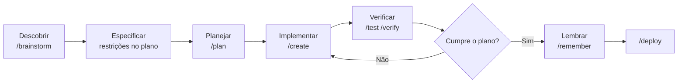
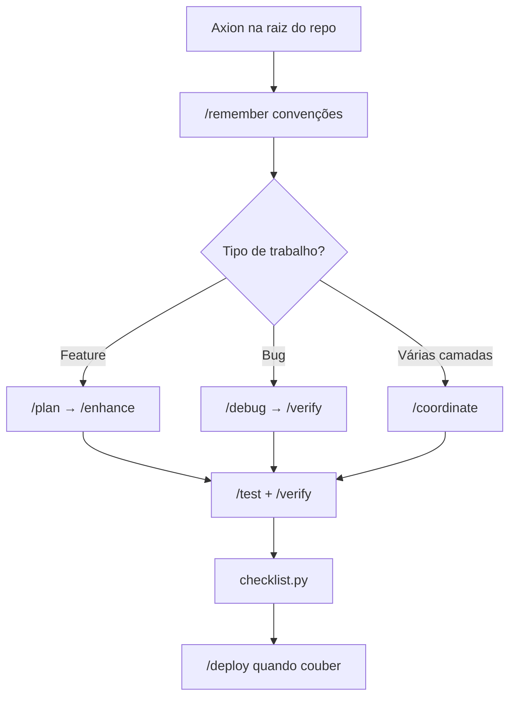

# Axion

Framework de Spec-Driven Development (SDD) para o Cursor IDE. A especificação é a fonte da verdade; o código deriva dela.

Repositório: [zanetta/axion](https://github.com/zanetta/axion) · Pacote: [`@zanetta/axion@1.0.2`](https://www.npmjs.com/package/@zanetta/axion)

---

## Spec-Driven Development

O trabalho segue um ciclo. Cada fase fecha um acordo antes da próxima escrever código:

**descobrir → especificar → planejar → implementar → verificar → lembrar**

| Fase | O que fica decidido | Command |
| --- | --- | --- |
| Descobrir | opções, riscos, escopo | `/brainstorm` |
| Especificar | problema, restrições e o que fica de fora | saída do `/brainstorm`, carregada no `/plan` |
| Planejar | passos, pastas, checklist | `/plan` |
| Implementar | código que segue o plano | `/create` (projeto novo) ou `/enhance` (código existente) |
| Verificar | evidência de que o resultado cumpre o plano | `/test`, `/verify`, `checklist.py` |
| Lembrar | decisões que a próxima sessão deve repetir | `/remember` |

A especificação, hoje, é esse acordo: problema, restrições e non-goals registrados na conversa e no plano. A direção do framework é gravar spec, plano e critérios de aceite como artefatos que a fase seguinte possa ler. Esses arquivos ainda não fazem parte do pacote.

Quem sustenta o ciclo são os slash commands, 20 agents, 45 skills e as regras em `AGENTS.md`. `/brainstorm` questiona stack, escopo e trade-offs antes de `/plan` ou `/create`. A fase seguinte começa quando você chama o command correspondente.

Commands de apoio, fora das seis fases: `/debug`, `/preview`, `/status`, `/deploy`, `/orchestrate`, `/coordinate`, `/ui-ux-pro-max`.

---

## Quick Start

### Instalar no projeto

Na raiz do repositório da aplicação:

```bash
npx @zanetta/axion init
```

O `init` instala no diretório atual. Exemplo: `cd ~/dev/meu-app && npx @zanetta/axion init`.

```bash
npm install -g @zanetta/axion
axion init
```

**O que o `init` copia:**

| Item | Destino |
| --- | --- |
| 20 agents | `.claude/agents/` |
| 45 skills (+ sub-skills de game-dev), memória e schemas | `.agents/` |
| 14 slash commands (13 + `/ui-ux-pro-max`), 7 regras por domínio, scripts, MCP | `.cursor/` |
| Regras globais e fluxo | `AGENTS.md`, `AGENT_FLOW.md` |
| Template de env | `.env.example` |

O `init` (e o `update`) também grava **`.axion/kit.manifest.json`** — estado local do kit (SemVer, profile). Não faz parte do template do pack. `npx @zanetta/axion status` lê esse manifesto e mostra a versão instalada (e compara com o latest no npm, se a rede responder).

**Merge é o padrão.** Arquivos novos entram; arquivos que já existem ficam como estão.

| Caminho | Comportamento |
| --- | --- |
| `.cursor/mcp.json` | Merge de servidores. Em conflito de nome, a config do projeto prevalece |
| `.cursor/rules/*.mdc` | Arquivo existente não é sobrescrito |
| Demais arquivos do kit | Ignorados se já existirem |

```bash
npx @zanetta/axion init --force     # sobrescreve os arquivos do kit
npx @zanetta/axion init --dry-run   # simula sem escrever
npx @zanetta/axion status
npx @zanetta/axion update           # merge de arquivos novos
npx @zanetta/axion update --force
npx @zanetta/axion update --dry-run
```

Use `--force` só quando quiser substituir customizações do kit.

### npm — erros comuns

| Erro | Ajuste |
| --- | --- |
| `E404` / `ENOVERSIONS` / `min-release-age` | `NPM_CONFIG_MIN_RELEASE_AGE=0 npx @zanetta/axion init` ou `npm config delete min-release-age` |
| `ENEEDAUTH` | Registry `registry.npmjs.org` (veja o `.npmrc` do projeto) |
| `E403` (2FA) | 2FA com `--otp=…`, ou token granular com bypass de 2FA |

Detalhes, publish e desenvolvimento local: [`cli/README.md`](cli/README.md). Tag `v*` dispara [`.github/workflows/publish-npm.yml`](.github/workflows/publish-npm.yml) (`NPM_TOKEN` no GitHub).

### Cópia manual

```bash
git clone https://github.com/zanetta/axion.git
# ou copie .claude/, .agents/, .cursor/, AGENTS.md e AGENT_FLOW.md
```

### MCP (opcional)

```bash
cp .env.example .env
# Edite CONTEXT7_API_KEY
```

Servidores em [`.cursor/mcp.json`](.cursor/mcp.json) (Context7, Playwright, shadcn).

### Validar

```bash
python3 .cursor/scripts/checklist.py .
python3 .cursor/scripts/verify_all.py . --url http://localhost:3000
```

Maintainers do kit (opcional): `python3 .cursor/scripts/lint_paths.py .` — falha se docs/commands ainda apontarem para o path legado `.agents/scripts/`.

Roadmap SDD (Fase 0 concluída; próxima: Fase 1): [`upgrade.md`](upgrade.md).

No chat do Agent, digite `/` para o autocomplete dos commands em `.cursor/commands/`.

---

## O ciclo com os commands

Sintaxe, no chat do **Agent**:

```text
/<comando> [descrição em texto livre]
```

O texto depois do comando é o pedido. Um command por mensagem. Commands que editam arquivos precisam de permissão de escrita no workspace.

| Command | Quando | Exemplo |
| --- | --- | --- |
| `/brainstorm` | Opções e arquitetura antes de codar | `/brainstorm qual stack usar para um SaaS multi-tenant?` |
| `/plan` | Plano e checklist a partir do que foi especificado | `/plan implementar autenticação JWT com refresh token` |
| `/create` | Feature ou app novo, seguindo o plano | `/create landing page Next.js com formulário de waitlist` |
| `/enhance` | Mudança em código que já existe | `/enhance adicionar paginação na listagem de usuários` |
| `/debug` | Bug com método sistemático | `/debug login retorna 401 após deploy` |
| `/test` | Gerar ou executar testes | `/test cobrir fluxo de checkout com Playwright` |
| `/verify` | Executar e provar que funciona | `/verify build passa após o refactor do módulo auth` |
| `/deploy` | Pré-flight e deploy | `/deploy preparar release para Vercel` |
| `/preview` | Servidor local | `/preview iniciar dev server na porta 3000` |
| `/status` | Progresso da tarefa atual | `/status` |
| `/orchestrate` | Vários specialists (mínimo 3) | `/orchestrate painel admin com CRUD e testes E2E` |
| `/coordinate` | Pesquisa em paralelo e síntese | `/coordinate revisar segurança e performance da API em paralelo` |
| `/remember` | Convenção entre sessões | `/remember prefiro bun em vez de npm neste projeto` |
| `/ui-ux-pro-max` | Direção visual | `/ui-ux-pro-max dashboard fintech dark mode minimalista` |

Definição de cada workflow: [`.cursor/commands/`](.cursor/commands/).

### Projeto novo

```bash
npx @zanetta/axion init
git add . && git commit -m "chore: add axion kit"
```

Descobrir, fixar o acordo e planejar:

```text
/brainstorm MVP de gestão de tarefas: web, auth, equipes, mobile depois. Restrição: deploy na Vercel.

/remember Stack: Next.js App Router, Prisma, PostgreSQL, Tailwind v4, bun. Sem tons roxo/violeta na UI.

/plan MVP com auth email/senha, CRUD de projetos e tarefas, dashboard. Incluir testes e schema DB.
```

Implementar em blocos. Um bloco do plano, `/verify`, o próximo. Escopo full-stack pode ir para `/coordinate` ou `/orchestrate` depois do `/plan`.

```text
/create seguir o plano em [nome-do-plano].md — monorepo não, app Next.js na raiz.

/ui-ux-pro-max dashboard produtividade, estilo clean, paleta neutra com acento verde.

/preview iniciar dev server e confirmar que a home carrega.
```

Verificar e, quando o plano estiver cumprido, preparar o release:

```text
/test unitários para services de tarefas e integração para API /api/projects

/verify rodar build, migrations e smoke test do fluxo login → criar tarefa

/status

/coordinate revisão final: segurança (auth), performance (LCP), testes E2E dos fluxos críticos

/deploy preparar release produção Vercel — variáveis de ambiente e migrations
```

```bash
python3 .cursor/scripts/checklist.py .
python3 .cursor/scripts/verify_all.py . --url http://localhost:3000
```



### Projeto que já tem código

```bash
npx @zanetta/axion init
```

O merge preserva rules e `mcp.json` do projeto. Não substitua `package.json` nem `src/` na cópia manual. Registre o que o repositório já faz:

```text
/remember Este projeto usa npm (não bun). ESLint flat config em eslint.config.mjs. API em src/server/.
```

Antes de uma mudança grande, peça um mapa do repo (agent `explorer-agent`, skill `architecture`):

```text
Explorar a estrutura do repo e resumir: stack, pastas principais, como rodar testes e build.
```

| Situação | Sequência |
| --- | --- |
| Feature no código existente | `/plan` → `/enhance` |
| Refatoração | `/brainstorm` → `/plan` → `/enhance` |
| Bug | `/debug` → `/verify` |
| Várias camadas | `/coordinate` ou `/orchestrate` |

Feature:

```text
/plan adicionar exportação CSV na listagem de pedidos — respeitar padrões em src/features/orders/

/enhance implementar export CSV async, limite 10k linhas, testes unitários no service

/test cobrir service de export e rota GET /api/orders/export

/verify build + testes + curl na rota com token de teste
```

Bug:

```text
/debug checkout falha no Safari iOS — cart fica vazio após refresh. Logs e passos anexados.

/verify reproduzir fix no fluxo guest checkout e logged-in
```

No dia a dia: leia `.agents/memory/MEMORY.md` no início da sessão; tarefa pequena vai de `/enhance`; tarefa média passa por `/plan` e `/verify`; antes do PR, `/test` e `python3 .cursor/scripts/checklist.py .`.

| Prefira | Evite |
| --- | --- |
| `/enhance` com plano incremental | `/create` para reescrever a aplicação |
| Convenções já presentes no código, gravadas com `/remember` | Inventar um estilo paralelo |
| `/verify` antes de `/deploy` | Release sem build e testes na sessão |
| Segredos em `.env` | Segredos no `/remember` |



Memória fica em `.agents/memory/` e volta nas sessões seguintes pela skill `memory-system`.

---

## Configuração

| Item | Onde | Nota |
| --- | --- | --- |
| `CONTEXT7_API_KEY` | `.env`, a partir de `.env.example` | MCP Context7. `.env` não vai para o git |
| Regras sempre ativas | `AGENTS.md` | Ciclo, roteamento, checklist |
| Regras por domínio | `.cursor/rules/*.mdc` | Sete arquivos. O `init` não sobrescreve os que já existem |
| MCP | `.cursor/mcp.json` | Merge; o projeto ganha em conflito de nome |
| Memória | `.agents/memory/MEMORY.md` | Preferências e convenções. Sem segredos |

Deixe `.agents/` indexado pelo Cursor se quiser autocomplete dos slash commands. Para tirá-lo do remoto sem perder a indexação local:

```bash
echo ".agents/" >> .git/info/exclude
```

---

## Estrutura

```
.
├── AGENTS.md                 # Regras sempre ativas
├── AGENT_FLOW.md             # Fluxo de agents e validação
├── README.md
├── upgrade.md                # Roadmap SDD (Fase 0 done → Fase 1)
├── package.json              # Workspace cli/
├── .npmrc                    # @zanetta → registry.npmjs.org
├── cli/                      # @zanetta/axion
├── .github/workflows/        # ci.yml + publish-npm.yml (tag v*)
├── .axion/                   # Estado local (kit.manifest.json via CLI)
├── .claude/agents/           # 20 agents
├── .agents/
│   ├── schemas/              # Contratos skill/command
│   ├── skills/               # 45 skills
│   └── memory/
└── .cursor/
    ├── ARCHITECTURE.md
    ├── commands/             # 14 slash commands
    ├── rules/                # 7 regras por domínio
    ├── scripts/              # checklist, verify_all, lint_paths, sync_upstream
    ├── shared/ui-ux-pro-max/
    └── mcp.json
```

| Documento | Conteúdo |
| --- | --- |
| [`.cursor/ARCHITECTURE.md`](.cursor/ARCHITECTURE.md) | Agents, skills, commands, npm, P0 |
| [`AGENT_FLOW.md`](AGENT_FLOW.md) | Fluxo de agents e validação |
| [`AGENTS.md`](AGENTS.md) | Regras sempre ativas |
| [`upgrade.md`](upgrade.md) | Backlog SDD — Fase 0 concluída; Fase 1 em seguida |
| [`cli/README.md`](cli/README.md) | CLI, manifesto SemVer, publish, troubleshooting |
| [`.cursor/scripts/README.md`](.cursor/scripts/README.md) | Scripts de validação e sync |

---

## Manutenção do kit

O script compara agents, skills, memória e commands com [zanetta/axion](https://github.com/zanetta/axion). Não altera `/ui-ux-pro-max`, `AGENTS.md`, `.cursor/rules/` nem este README.

```bash
python3 .cursor/scripts/lint_paths.py .                  # drift de paths (legado .agents/scripts/)
python3 .cursor/scripts/sync_upstream.py                 # comparar
python3 .cursor/scripts/sync_upstream.py --apply         # aplicar
python3 .cursor/scripts/sync_upstream.py --apply --clone # clonar a origem e aplicar
```

Revise o diff do dry-run antes de `--apply`.

---

## Licença

[MIT](LICENSE).
