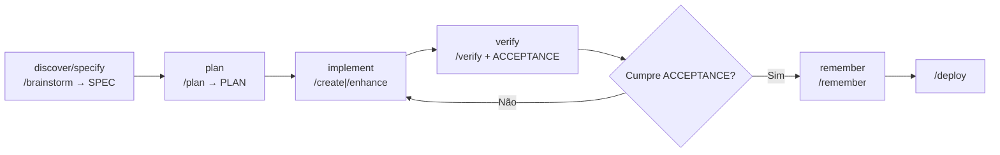
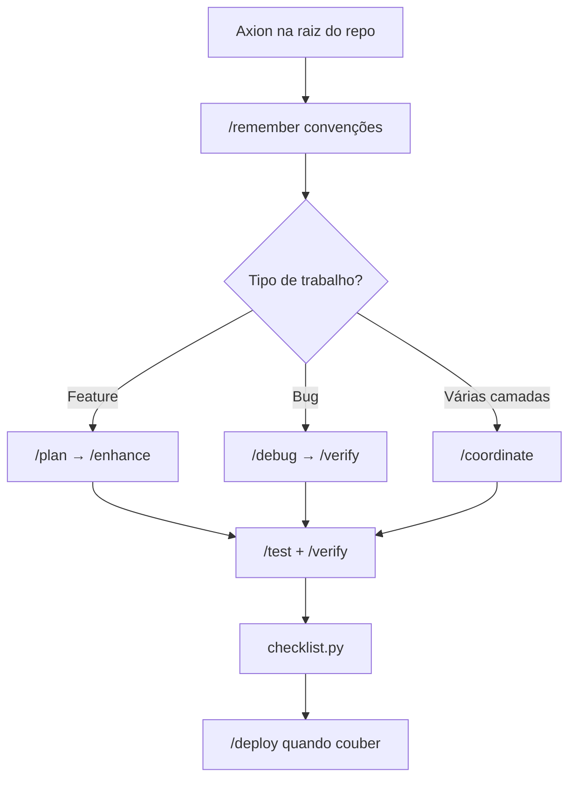

# Axion

Framework de Spec-Driven Development (SDD) para o Cursor IDE. A especificação é a fonte da verdade; o código deriva dela.

Repositório: [zanetta/axion](https://github.com/zanetta/axion) · Pacote: [`@zanetta/axion@1.1.0`](https://www.npmjs.com/package/@zanetta/axion)

| | |
| --- | --- |
| [Introdução](#spec-driven-development) | O que o kit é |
| [Instalação](#quick-start) | `init`, profiles, o que é copiado |
| [Troubleshooting da instalação](#troubleshooting-da-instalação) | `npx`, diretório, profile, arquivos protegidos |
| [FSM](#spec-driven-development) | Estados e o que cada um exige |
| [Fluxo de trabalho](#fluxo-de-trabalho) | Projeto do zero e projeto que já existe |
| [Comandos e skills](#comandos-e-skills) | O que cada `/comando` carrega |
| [Cada comando](#cada-comando) | Quando usar e o que ele produz |

---

## Spec-Driven Development

O trabalho segue a FSM: `discover → specify → plan → implement → verify → remember`. Cada fase fecha um acordo (artefato) antes da próxima escrever código.

| Estado | Artefato / decisão | Command |
| --- | --- | --- |
| `discover` / `specify` | SPEC (problema, actors, constraints, non-goals) | `/brainstorm` |
| `plan` | PLAN + links para SPEC/ACCEPTANCE | `/plan` |
| `implement` | código que segue o PLAN | `/create` ou `/enhance` |
| `verify` | ACCEPTANCE + evidência de execução | `/verify` (e `/test`, `checklist.py`) |
| `remember` | decisões cross-session | `/remember` |

O que cada estado exige:

| Estado | Pode avançar quando |
| --- | --- |
| `discover` / `specify` | Existe `{slug}.spec.md` **ou** três perguntas respondidas no SPEC/PLAN. Célula com `{placeholder}` não conta. |
| `plan` | O usuário aprovou `{slug}.plan.md` (ou o legado `{slug}.md`) e o `{slug}.acceptance.md`. |
| `implement` | O plano está aprovado. App novo usa `/create`. Código que já existe usa `/enhance`. Correção pequena pode seguir depois de confirmar o impacto. |
| `verify` | Os critérios AC-* têm evidência e `[x]`, o checklist sai 0 e o `verify_gate.py` sai 0. |
| `remember` | A nota passou no `memory_secret_scan.py`. Segredo não entra em `.agents/memory/`. |

Commands de apoio: `/debug`, `/preview`, `/status`, `/deploy`, `/orchestrate`, `/coordinate`, `/ui-ux-pro-max`.

---

## Quick Start

### Instalar no projeto

Na raiz do repositório da aplicação:

```bash
npx @zanetta/axion init
npx @zanetta/axion init --profile standard
npx @zanetta/axion init --profile security   # inclui red-team / penetration-tester
```

O `init` instala no diretório atual. Exemplo: `cd ~/dev/meu-app && npx @zanetta/axion init`. Profiles e `--enable-offensive`: [`cli/README.md`](cli/README.md).

```bash
npm install -g @zanetta/axion
axion init --profile standard
```

**O que o** `init` **copia:**

| Item | Destino |
| --- | --- |
| Agents do profile | `.claude/agents/` |
| Skills do profile (+ sub-skills de game-dev), memória e schemas | `.agents/` |
| 14 slash commands (13 + `/ui-ux-pro-max`), 7 regras por domínio, scripts, MCP | `.cursor/` |
| Regras globais e fluxo | `AGENTS.md`, `AGENT_FLOW.md` |
| Template de env | `.env.example` |

O `init` (e o `update`) também grava `.axion/kit.manifest.json` — estado local do kit (SemVer, profile). Não faz parte do template do pack. `npx @zanetta/axion status` lê esse manifesto e mostra a versão instalada (e compara com o latest no npm, se a rede responder).

**Merge é o padrão.** Arquivos novos entram; arquivos que já existem ficam como estão.

| Caminho | Comportamento |
| --- | --- |
| `.cursor/mcp.json` | Merge de servidores. Em conflito de nome, a config do projeto prevalece |
| `.cursor/rules/*.mdc` | Arquivo existente não é sobrescrito |
| Demais arquivos do kit | Ignorados se já existirem |

```bash
npx @zanetta/axion init --force     # sobrescreve arquivos do kit que não são protegidos
npx @zanetta/axion init --dry-run   # simula sem escrever
npx @zanetta/axion status
npx @zanetta/axion update           # merge de arquivos novos
npx @zanetta/axion update --force
npx @zanetta/axion update --dry-run
```

Use `--force` só quando quiser substituir customizações do kit.

### npm — erros comuns

| Erro | Ajuste |
| --- | --- |
| `E404` / `ENOVERSIONS` / `min-release-age` | `NPM_CONFIG_MIN_RELEASE_AGE=0 npx @zanetta/axion init` ou `npm config delete min-release-age` |
| `ENEEDAUTH` | Registry `registry.npmjs.org` (veja o `.npmrc` do projeto) |
| `E403` (2FA) | 2FA com `--otp=…`, ou token granular com bypass de 2FA |

Detalhes, publish e desenvolvimento local: [`cli/README.md`](cli/README.md). Tag `v*` dispara [`.github/workflows/publish-npm.yml`](.github/workflows/publish-npm.yml) (`NPM_TOKEN` no GitHub), que só publica após o gate de CI (lint de paths + contratos + paridade doc/inventário + testes/smoke) e se a tag for igual à versão de `cli/package.json`.

### Troubleshooting da instalação

| Sintoma | O que fazer |
| --- | --- |
| `npx` não acha o pacote recém-publicado | `NPM_CONFIG_MIN_RELEASE_AGE=0 npx @zanetta/axion init`. Confira com `npm view @zanetta/axion version`. |
| O kit caiu na pasta errada | `init` grava no diretório atual. Entre na raiz do app e rode de novo. |
| `/comando` não aparece no chat | Os commands estão em `.cursor/commands/`. Abra a raiz do projeto no Cursor e digite `/` no Agent. |
| Troquei para `minimal` e os agents antigos continuam | O CLI não apaga arquivo do projeto. O que ficou de fora do profile aparece como *outside profile* e sai só se você remover. |
| `--force` e o SPEC/PLAN sumiu | Não deve sumir. `*.spec.md`, `*.plan.md`, `*.acceptance.md`, `.agents/memory/`, `.axion/logs/` e `.axion/trace/` (exceto o `README.md`) não são sobrescritos se já existem. |
| `update` diz que há drift | A lista é informativa. Sem `--force`, o arquivo local fica. Com `--force`, só arquivo do kit que não é protegido é substituído. |
| `status` não mostra o manifesto | Rode `init` ou `update` de novo. O `.axion/kit.manifest.json` é gravado pelo CLI, não vem no template. |
| Script Python falha ao verificar | Vários commands chamam `python3`. Sem Python 3 no PATH, checklist e gate não rodam. |

### Cópia manual

```bash
git clone https://github.com/zanetta/axion.git
# ou copie .claude/, .agents/, .cursor/, AGENTS.md e AGENT_FLOW.md
```

### MCP (opcional)

```bash
cp .env.example .env
# Edite CONTEXT7_API_KEY
```

Servidores em [`.cursor/mcp.json`](.cursor/mcp.json) (Context7, Playwright, shadcn).

---

## Fluxo de trabalho

Um command por mensagem, no chat do Agent: `/<comando>` e o pedido em texto livre. Commands que editam arquivos pedem permissão de escrita.

| Command | Quando | Exemplo |
| --- | --- | --- |
| `/brainstorm` | Opções e arquitetura antes de codar | `/brainstorm qual stack usar para um SaaS multi-tenant?` |
| `/plan` | Plano e checklist a partir do que foi especificado | `/plan implementar autenticação JWT com refresh token` |
| `/create` | Feature ou app novo, seguindo o plano | `/create landing page Next.js com formulário de waitlist` |
| `/enhance` | Mudança em código que já existe | `/enhance adicionar paginação na listagem de usuários` |
| `/debug` | Bug com método sistemático | `/debug login retorna 401 após deploy` |
| `/test` | Gerar ou executar testes | `/test cobrir fluxo de checkout com Playwright` |
| `/verify` | Executar e provar que funciona | `/verify build passa após o refactor do módulo auth` |
| `/deploy` | Pré-flight e deploy | `/deploy preparar release para Vercel` |
| `/preview` | Servidor local | `/preview iniciar dev server na porta 3000` |
| `/status` | Progresso da tarefa atual | `/status` |
| `/orchestrate` | Vários specialists (mínimo 3) | `/orchestrate painel admin com CRUD e testes E2E` |
| `/coordinate` | Pesquisa em paralelo e síntese | `/coordinate revisar segurança e performance da API em paralelo` |
| `/remember` | Convenção entre sessões | `/remember prefiro bun em vez de npm neste projeto` |
| `/ui-ux-pro-max` | Direção visual | `/ui-ux-pro-max dashboard fintech dark mode minimalista` |

Definição de cada workflow: [`.cursor/commands/`](.cursor/commands/). A lista com as skills e o texto de cada command estão em [Comandos e skills](#comandos-e-skills) e [Cada comando](#cada-comando).

### a) Projeto iniciado do zero

App que ainda não existe. Instale o kit, feche o SPEC e o PLAN, e só então peça código.

```bash
npx @zanetta/axion init
git add . && git commit -m "chore: add axion kit"
```

Descobrir, fixar o acordo e planejar:

```text
/brainstorm MVP de gestão de tarefas: web, auth, equipes, mobile depois. Restrição: deploy na Vercel.

/remember Stack: Next.js App Router, Prisma, PostgreSQL, Tailwind v4, bun. Sem tons roxo/violeta na UI.

/plan MVP com auth email/senha, CRUD de projetos e tarefas, dashboard. Incluir testes e schema DB.
```

Implementar em blocos. Um bloco do plano, `/verify`, o próximo. Escopo full-stack pode ir para `/coordinate` ou `/orchestrate` depois do `/plan`.

```text
/create seguir o plano em [nome-do-plano].md — monorepo não, app Next.js na raiz.

/ui-ux-pro-max dashboard produtividade, estilo clean, paleta neutra com acento verde.

/preview iniciar dev server e confirmar que a home carrega.
```

Verificar e, quando o plano estiver cumprido, preparar o release:

```text
/test unitários para services de tarefas e integração para API /api/projects

/verify rodar build, migrations e smoke test do fluxo login → criar tarefa

/status

/coordinate revisão final: segurança (auth), performance (LCP), testes E2E dos fluxos críticos

/deploy preparar release produção Vercel — variáveis de ambiente e migrations
```

```bash
python3 .cursor/scripts/checklist.py .
python3 .cursor/scripts/verify_all.py . --url http://localhost:3000
```



### b) Projeto que já está em andamento

```bash
npx @zanetta/axion init
```

O merge preserva rules e `mcp.json` do projeto. Não substitua `package.json` nem `src/` na cópia manual. Registre o que o repositório já faz:

```text
/remember Este projeto usa npm (não bun). ESLint flat config em eslint.config.mjs. API em src/server/.
```

Antes de uma mudança grande, peça um mapa do repo (agent `explorer-agent`, skill `architecture`):

```text
Explorar a estrutura do repo e resumir: stack, pastas principais, como rodar testes e build.
```

| Situação | Sequência |
| --- | --- |
| Feature no código existente | `/plan` → `/enhance` |
| Refatoração | `/brainstorm` → `/plan` → `/enhance` |
| Bug | `/debug` → `/verify` |
| Várias camadas | `/coordinate` ou `/orchestrate` |

Feature:

```text
/plan adicionar exportação CSV na listagem de pedidos — respeitar padrões em src/features/orders/

/enhance implementar export CSV async, limite 10k linhas, testes unitários no service

/test cobrir service de export e rota GET /api/orders/export

/verify build + testes + curl na rota com token de teste
```

Bug:

```text
/debug checkout falha no Safari iOS — cart fica vazio após refresh. Logs e passos anexados.

/verify reproduzir fix no fluxo guest checkout e logged-in
```

No dia a dia: leia `.agents/memory/MEMORY.md` no início da sessão; tarefa pequena vai de `/enhance`; tarefa média passa por `/plan` e `/verify`; antes do PR, `/test` e `python3 .cursor/scripts/checklist.py .`.

| Prefira | Evite |
| --- | --- |
| `/enhance` com plano incremental | `/create` para reescrever a aplicação |
| Convenções já presentes no código, gravadas com `/remember` | Inventar um estilo paralelo |
| `/verify` antes de `/deploy` | Release sem build e testes na sessão |
| Segredos em `.env` | Segredos no `/remember` |



Memória fica em `.agents/memory/` e volta nas sessões seguintes pela skill `memory-system`.

---

## Comandos e skills

O frontmatter de cada arquivo em `.cursor/commands/` declara as skills que o agent deve ler. Onde a coluna está vazia, o command não declara `required_skills`.

| Command | Skills |
| --- | --- |
| `/brainstorm` | `brainstorming` |
| `/plan` | `plan-writing`, `brainstorming` |
| `/create` | `app-builder`, `brainstorming`, `plan-writing` |
| `/enhance` | `plan-writing`, `brainstorming` |
| `/verify` | `verify-changes` |
| `/remember` | `memory-system` |
| `/orchestrate` | `parallel-agents`, `coordinator-mode`, `plan-writing` |
| `/coordinate` | `coordinator-mode` (pedido no corpo do command; o frontmatter não lista `required_skills`) |
| `/status` | — |
| `/debug` | — |
| `/test` | — |
| `/deploy` | — |
| `/preview` | — (usa `.cursor/scripts/auto_preview.py`) |
| `/ui-ux-pro-max` | — (usa `.cursor/shared/ui-ux-pro-max/scripts/search.py`) |

## Cada comando

### `/brainstorm`

Estado `discover` / `specify`. Explora opções e grava `{slug}.spec.md`. Não escreve código da aplicação. Sem `{slug}.spec.md`, três respostas reais registradas no PLAN também abrem o `/plan`.

### `/plan`

Estado `plan`. O `project-planner` produz `{slug}.plan.md` e `{slug}.acceptance.md` a partir dos templates. Exige SPEC ou três respostas reais, e para antes de codar até você aprovar. A seção `## Write allowlist` lista os paths que a implementação pode alterar.

### `/create`

Estado `implement` para aplicação nova. Sem PLAN aprovado, volta para `/brainstorm` e `/plan`. Com o plano aprovado, a skill `app-builder` coordena schema, API e UI. No fim, prefira `/verify` e, se couber, `.cursor/scripts/auto_preview.py`.

### `/enhance`

Estado `implement` em código que já existe. Mudança grande pede PLAN ou três respostas e o seu OK. Correção pequena segue depois de confirmar o impacto. O primeiro passo lê o projeto com `python3 .cursor/scripts/session_manager.py info`.

### `/verify`

Estado `verify`. Prova por execução. Ordem: gravar evidência em cada AC-*, `python3 .cursor/scripts/checklist.py .`, depois `python3 .cursor/scripts/verify_gate.py . --acceptance {slug}.acceptance.md`. Os dois precisam sair 0. O gate roda o checklist de novo e não repete os comandos dos AC-*. Sem arquivo de acceptance, o gate aceita `--allow-missing-acceptance` e o checklist continua. Em seguida, `trace_report.py` (se houver slug) e o log em `.axion/logs/runs.jsonl`.

### `/test`

Gera ou roda testes do alvo que você nomear, inclusive coverage e watch. Não substitui o `/verify`: o teste é uma evidência; o gate é quem fecha a tarefa.

### `/debug`

Investigação sistemática: sintoma, hipóteses, teste de cada hipótese, causa e correção.

### `/preview`

Sobe, para ou consulta o servidor local. Por baixo, `python3 .cursor/scripts/auto_preview.py start|stop|status`.

### `/status`

Mostra o quadro do projeto e pede o doctor do kit: `python3 .cursor/scripts/session_manager.py doctor .` (linhas do índice de memória, path lint e o último `/verify`).

### `/deploy`

Pré-flight e release. O command cobre checagem, preview, produção e rollback. Ele não publica o pacote npm do Axion; isso é a tag `v*` e o workflow `publish-npm.yml`.

### `/orchestrate`

Vários specialists no mesmo pedido, no mínimo três. Não despacha workers sem SPEC ou três respostas e sem PLAN. Antes de cada escrita, o path tem de estar na allowlist. Antes de cada dispatch ou retry, `circuit_breaker.py` decide se ainda dá para lançar. No fim, o log pode receber os contadores `--workers`, `--failures`, `--duration-ms` e `--breaker-trips`.

### `/coordinate`

Pesquisa em paralelo e síntese. O corpo do command manda ler `coordinator-mode`. Leituras em paralelo; escritas em sequência, só nos paths da allowlist, com `circuit_breaker.py` antes de cada dispatch.

### `/remember`

Estado `remember`. Grava preferência ou decisão em `.agents/memory/`. Antes de escrever, `python3 .cursor/scripts/memory_secret_scan.py` precisa sair 0. Exit 1 recusa o texto e não mostra o segredo.

### `/ui-ux-pro-max`

Consulta o guia visual em `.cursor/shared/ui-ux-pro-max/` (estilos, paletas, tipos, UX). A busca é `python3 .cursor/shared/ui-ux-pro-max/scripts/search.py`. Em seguida sintetiza o design system e implementa a tela.

## Configuração

| Item | Onde | Nota |
| --- | --- | --- |
| `CONTEXT7_API_KEY` | `.env`, a partir de `.env.example` | MCP Context7. `.env` não vai para o git |
| Regras sempre ativas | `AGENTS.md` | Ciclo, roteamento, checklist |
| Regras por domínio | `.cursor/rules/*.mdc` | Sete arquivos. O `init` não sobrescreve os que já existem |
| MCP | `.cursor/mcp.json` | Merge; o projeto ganha em conflito de nome |
| Memória | `.agents/memory/MEMORY.md` | Preferências e convenções. Sem segredos |

Deixe `.agents/` indexado pelo Cursor se quiser autocomplete dos slash commands. Para tirá-lo do remoto sem perder a indexação local:

```bash
echo ".agents/" >> .git/info/exclude
```

---

## Estrutura

```
.
├── AGENTS.md                 # Regras sempre ativas
├── AGENT_FLOW.md             # Fluxo de agents e validação
├── README.md
├── package.json              # Workspace cli/
├── .npmrc                    # @zanetta → registry.npmjs.org
├── cli/                      # @zanetta/axion
├── .github/workflows/        # ci.yml (reusável) + publish-npm.yml (tag v*, gate pre-publish)
├── .axion/                   # kit.manifest.json, inventory.json, trace/ (consumidor recebe só trace/README.md)
├── .claude/agents/           # 20 agents
├── .agents/
│   ├── schemas/              # Contratos skill/command
│   ├── skills/               # 45 skills (+ templates SPEC/PLAN/ACCEPTANCE)
│   └── memory/
└── .cursor/
    ├── ARCHITECTURE.md
    ├── commands/             # 14 slash commands
    ├── rules/                # 7 regras por domínio
    ├── scripts/              # checklist, verify_all, lint_paths, generate_inventory, …
    ├── shared/ui-ux-pro-max/
    └── mcp.json
```

| Documento | Conteúdo |
| --- | --- |
| [`.cursor/ARCHITECTURE.md`](.cursor/ARCHITECTURE.md) | Agents, skills, FSM SDD, npm, P0/P1 |
| [`AGENT_FLOW.md`](AGENT_FLOW.md) | Fluxo de agents, FSM e gates |
| [`AGENTS.md`](AGENTS.md) | Regras sempre ativas |
| [`cli/README.md`](cli/README.md) | CLI, profiles, manifesto SemVer, publish |
| [`.cursor/scripts/README.md`](.cursor/scripts/README.md) | Scripts de validação e sync |

---

## Manutenção do kit

O script compara agents, skills, memória e commands com [zanetta/axion](https://github.com/zanetta/axion). Não altera `/ui-ux-pro-max`, `AGENTS.md`, `.cursor/rules/` nem este README.

```bash
python3 .cursor/scripts/lint_paths.py .                  # drift de paths (legado .agents/scripts/)
python3 .cursor/scripts/sync_upstream.py                 # comparar
python3 .cursor/scripts/sync_upstream.py --apply         # aplicar
python3 .cursor/scripts/sync_upstream.py --apply --clone # clonar a origem e aplicar
```

Revise o diff do dry-run antes de `--apply`.

---

## Licença

[MIT](LICENSE).
